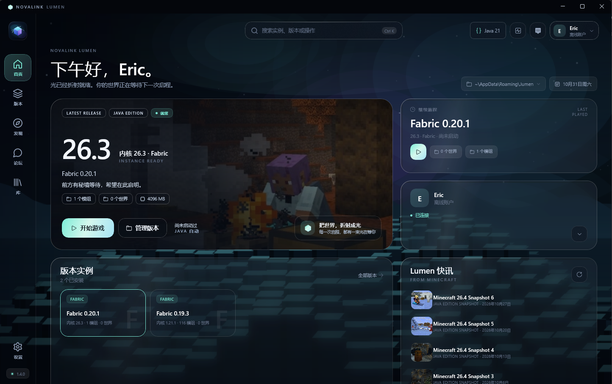
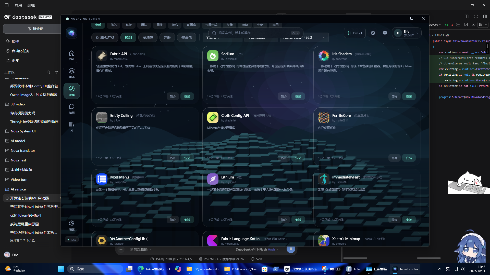
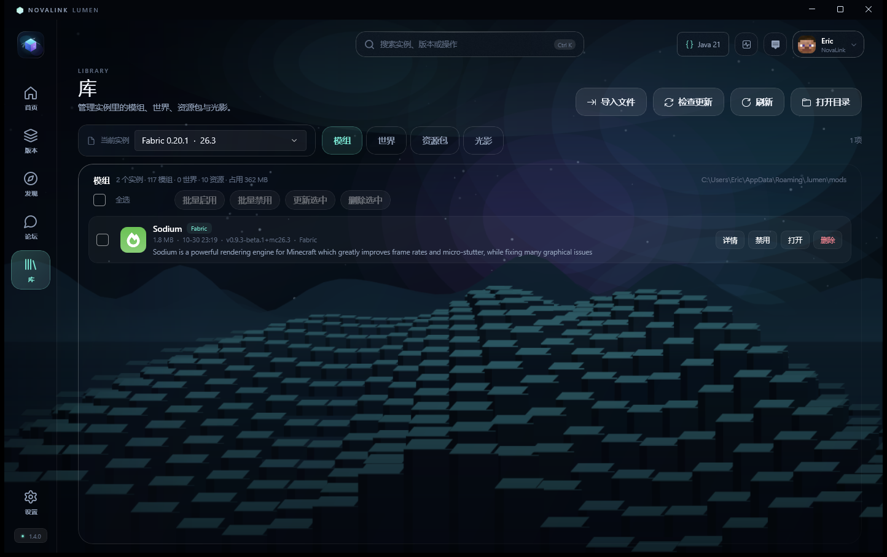
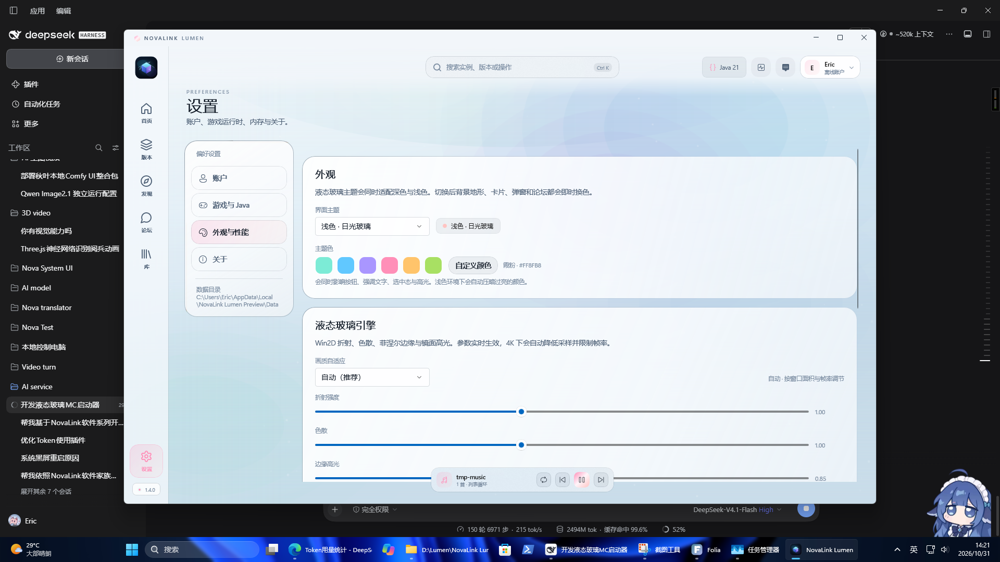
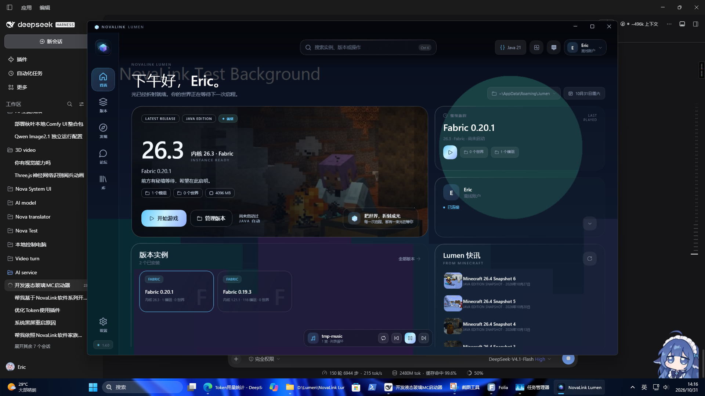

# NovaLink Lumen

NovaLink Lumen 是 NovaLink 系列的 Minecraft Java Edition 启动器，使用 **C#、.NET 10、WinUI 3 与 Win2D** 原生构建。

它把版本管理、模组与整合包、账户、下载、论坛和个性化外观放在同一个桌面界面里，同时保留 Minecraft 原有的游戏目录与数据。

- 当前版本：**V1.5.1**（正式版；测试版通道说明见 [docs/PREVIEW.md](docs/PREVIEW.md)）
- 系统：Windows 10 19041+ / Windows 11，x64
- 运行环境：自包含发布，安装包已包含 .NET 与 Windows App SDK 运行时
- 许可证：MIT

> NovaLink Lumen 与 Mojang Studios、Microsoft 没有隶属关系，也未获得其背书。



## 功能

### 首页

- 按时间变化的问候、当前实例 Hero、继续旅程、账户卡、版本实例与 Lumen 快讯
- Win2D 极光背景、方块地面、玻璃卡片、菲涅尔边缘与明暗主题
- 自定义主题色、图片 / 视频背景、背景音乐与底部播放器

### 版本与启动

- 扫描并合并原版、Fabric、Quilt、Forge、NeoForge 实例
- 安装原版游戏，或直接安装 Fabric / Quilt / Forge / NeoForge 加载器
- 自动下载并校验游戏文件、资源索引与 Java 运行时
- 版本继承、独立游戏目录、重命名、自定义图标、移入回收站
- 启动参数、内存与 JVM 参数、Microsoft 令牌刷新、启动日志与崩溃诊断
- 中文界面预配置，支持整合包拖拽导入（`.mrpack` / ZIP）

### 发现

- Modrinth 实时目录，支持模组、资源包、光影与整合包
- 中文关键词与描述，英文项目名后附带中文名
- 版本、加载器、分类筛选，分页加载与骨架屏
- 项目详情、图库、依赖、版本与文件选择、安装到指定实例

### 论坛与动态

- 话题、回复、动态、评论与个人主页
- 发言冷却、创建话题门槛与 AI 审核状态
- 离线只读，NovaLink / Microsoft 账户可参与

### 库

- 模组启用 / 禁用 / 删除、世界、资源包、光影
- 打开实例目录、导入文件、检查更新

### 账户

- 离线账户
- Microsoft 正版登录
- NovaLink 账户
- NovaLink 绑定 Microsoft 后，使用 Microsoft 的名称、皮肤与档案启动

### 设置

- 游戏目录、版本隔离、Java 运行时、下载线程
- 外观、主题色、Win2D 玻璃参数、背景与音乐
- GitHub Releases 检查更新
- 卸载时默认保留账户、实例与游戏数据；升级前自动把数据备份到 `%LOCALAPPDATA%\NovaLink Lumen\Data_Backup_v<源版本>`

## 截图

| 发现 | 库 |
| --- | --- |
|  |  |

| 浅色外观 | 自定义背景 |
| --- | --- |
|  |  |

## 构建

需要：

- Windows 10 19041+ / Windows 11 x64
- [.NET 10 SDK](https://dotnet.microsoft.com/)
- Visual Studio 2022/2026（可选，仅用于设计器）
- NSIS 3.0.4+（仅打包安装器时需要）

还原并构建：

```powershell
dotnet build src/NovaLink.Lumen/NovaLink.Lumen.csproj -c Debug -p:Platform=x64
```

运行：

```powershell
src/NovaLink.Lumen/bin/x64/Debug/net10.0-windows10.0.19041.0/win-x64/NovaLink.Lumen.exe
```

发布自包含版本并打安装包（推荐一步到位）：

```powershell
powershell -ExecutionPolicy Bypass -File scripts\build.ps1
```

脚本会先做“上一版本已归档”闸门，再 publish、makensis，最后核对安装包产品版本并打印 SHA256。
单独执行时也可以用：

```powershell
dotnet publish src/NovaLink.Lumen/NovaLink.Lumen.csproj -c Release -r win-x64 --self-contained true -p:Platform=x64 -o dist/release
makensis installer/installer.nsi
```

> 发布目录需要同时包含 `NovaLink.Lumen.pri` 与 `Assets` 资源；项目已通过 `CopyPriToPublish` 和 Content 规则自动补齐。

## 目录

```text
src/NovaLink.Lumen.Core        模型、路径、加载器识别、崩溃解析
src/NovaLink.Lumen.Services    账户、Microsoft、NovaLink、Java、实例、启动、安装、Modrinth、论坛、库、更新
src/NovaLink.Lumen             WinUI 3 应用（Shell、页面、对话框、Win2D 控件）
installer                      NSIS 安装脚本
docs                           架构、发布与截图
scripts                        构建辅助脚本（build / bump-version / archive-release）
archives                       发版产物离线归档（规则见 archives/README.md）
```

更完整的模块说明见 [docs/ARCHITECTURE.md](docs/ARCHITECTURE.md)，发布流程见 [docs/PUBLISHING.md](docs/PUBLISHING.md)。

## 数据与隐私

- 启动器数据：`%LOCALAPPDATA%\NovaLink Lumen\LauncherData`
- 游戏目录默认：`%APPDATA%\.lumen`
- 账户令牌只保存在本机，并使用 Windows DPAPI（`safeStorage` 等价能力）加密
- 卸载时默认保留启动器数据；只有用户明确选择才会删除
- 游戏目录、世界与整合包不会被自动删除

首次启动会从旧版 `%LOCALAPPDATA%\NovaLink Lumen Preview\Data` 或 Electron 稳定版的 `%LOCALAPPDATA%\NovaLink Lumen\Data` 迁移账户、皮肤、图标、Java 与实例配置（取较新的配置）；旧目录保留，不删除。来自 Electron 的加密令牌无法被原生版解密，会在迁移时清空，需要重新登录一次。

## 第三方服务

- Modrinth API：模组、资源包、光影与整合包目录
- Mojang / Microsoft：版本清单、资源下载与正版登录
- NovaLink 官方服务：账户、论坛、动态与审核
- 首页 AI 标语由 NovaLink 官方服务端代理生成，客户端源码不包含任何第三方 API Key；自建服务时请在服务端配置 AI，客户端不直连模型。

本仓库只包含桌面启动器源码，不包含 NovaLink 服务端、管理后台、用户数据或部署凭据。

## 参与贡献

见 [CONTRIBUTING.md](CONTRIBUTING.md)。安全问题请按 [SECURITY.md](SECURITY.md) 私下报告。

## 许可证

源代码以 [MIT License](LICENSE) 发布。第三方内容与商标说明见 [NOTICE.md](NOTICE.md)。
